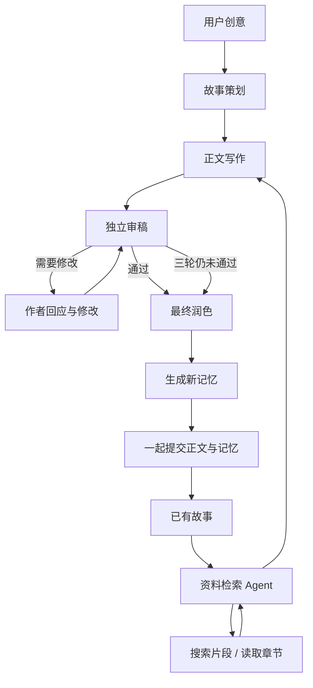

# 多 Agent 小说创作系统

一个使用 DeepSeek 与 Gradio 构建的长篇小说协作创作工具。系统将复杂写作任务拆分为七个协作角色，并通过共享故事状态、编辑质询和写作回应保持人物、事实与情节的一致性。

## 系统设计



## Agent 能力

- **工具使用**：续写时，资料 Agent 根据任务和历史工具结果选择 `search_story`、`read_chapter` 或 `finish`。Python 执行真实的本地正文查询，将结果回传给 Agent，并交给写作与审稿角色。每轮最多三个动作；开篇没有历史正文，因此跳过检索。
- **反馈循环**：审稿输出 `decision=approve/revise`。通过时跳过作者回应；要求修改时将意见交给作者，修改稿返回审稿复核。最多三轮审稿、两轮作者修改；仍未通过则将剩余问题与最新稿件交给修订 Agent 做最终裁决，完成后明确标注“未获审稿通过”，不再直接结束本轮。存在 `conflicts` 时即使返回 approve 也不会通过。
- **固定导航**：右侧提供“小说正文 / Agent 对话 / 本轮审稿”三个标签，各内容区域独立滚动，查看长审稿时标签栏不会被一起卷走。
- **实时对话**：界面展示发送方、接收方和消息类型，支持逐步显示策划、初稿、编辑质询、作者接受/拒绝及依据、修改稿、最终正文、记忆摘要，以及工具调用目的和真实查询结果。修改稿和记忆生成期间不再只更新状态文字。
- **共享故事状态**：长期设定、摘要、事实、未决线索、最近两幕原文与检索证据共同构成写作上下文。
- **一致提交**：最终正文和更新后的记忆全部生成成功后才写入正式故事。模型或解析失败时保留此前正文、记忆和计划，对话中显示失败原因。
- **结构化与流式输出**：业务角色使用 JSON，最终润色使用纯文本；JSON 尚未完整时提取字段用于预览，结束后解析并检查必要字段。

工具调用使用项目自定义的 JSON 动作协议，不使用供应商原生 function calling；历史查询是本地关键词检索，不是向量检索。角色共用一个模型，由 Python 调度，不是多个独立训练的模型。

## 实现边界与面试讲解

主要工程点是“模型选择动作 → 执行工具 → 反馈观察”的循环、有界的审稿路由、结构化角色消息、生成器驱动的实时 UI 和正文/记忆提交边界。审稿通过后的最终润色只改表达；达到审稿上限时，最终修订负责解决剩余分歧。最终修订没有再次审稿，因此不能宣称保证小说无事实矛盾。

界面使用会话内存，尚未实现故事保存/恢复；`demo.py` 可以导出最终正文。下一幕计划仍来自初稿。模型质量、真实调用延迟和费用尚未量化评估。检索可能增加最多三次模型请求，审稿最多三次、回应最多两次。

测试使用假模型接口，覆盖直接通过、退回后通过、达到轮次上限后进入最终修订、修改稿和记忆的实时对话、历史工具结果传递、记忆失败不提交、流式显示及布局。它们验证调度行为，不替代真实模型效果评估。

## 快速开始

### 1. 安装依赖

建议使用 Python 3.10 或更高版本。

```bash
python -m pip install -r requirements.txt
```

### 2. 配置 DeepSeek

PowerShell：

```powershell
$env:DEEPSEEK_API_KEY="你的 API Key"
$env:DEEPSEEK_MODEL="deepseek-flash"
```

macOS / Linux：

```bash
export DEEPSEEK_API_KEY="你的 API Key"
export DEEPSEEK_MODEL="deepseek-flash"
```

模型名称与价格请以 [DeepSeek 官方文档](https://api-docs.deepseek.com/quick_start/pricing/) 为准。

### 3. 启动界面

```bash
python app.py
```

打开 `http://127.0.0.1:7860` 即可使用。

### 4. 运行测试

```bash
python -m unittest discover -s tests -v
```

## 项目结构

```text
.
├── app.py
├── demo.py
├── novel_system/
│   ├── llm.py
│   ├── prompts.py
│   └── workflow.py
├── tests/
│   ├── test_collaboration.py
│   └── test_ui_layout.py
├── .env.example
└── requirements.txt
```

## License

MIT License

可选浏览器回归：安装 playwright 后运行 `python tests/browser_tabs.py`。脚本使用本机 Chrome 和假模型，在流式输出期间切换审稿/对话并滚动长审稿，验证标签仍留在可视区；不调用真实 API。
