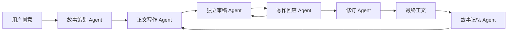

# 多 Agent 小说创作系统

一个使用 DeepSeek 与 Gradio 构建的长篇小说协作创作工具。系统将复杂写作任务拆分为六个协作角色，并通过共享故事状态、编辑质询和写作回应保持人物、事实与情节的一致性。

## 系统设计



- **故事策划 Agent**：建立世界规则、人物动机、核心冲突和阶段剧情。
- **正文写作 Agent**：依据当前计划与故事状态创作完整场景。
- **独立审稿 Agent**：检查设定冲突、人物动机、叙事因果和内容重复。
- **写作回应 Agent**：逐项回答编辑质询，接受或有依据地拒绝建议，并提交新草稿。
- **修订 Agent**：综合审稿意见和写作回应，完成最终编辑裁决。
- **故事记忆 Agent**：压缩已发生剧情，维护后续创作必须遵守的事实清单。

每个 Agent 都使用独立提示词和固定 JSON 输出契约。正文只有经过“写作 → 审稿质询 → 写作回应 → 修订裁决”后才会写入故事状态，避免 Agent 只是排队生成、彼此没有交流。

## 功能特点

- 基于共享 `StoryState` 管理大纲、计划、正文、长期记忆和事实清单。
- 使用 `deepseek-flash` 降低多 Agent 串行调用成本。
- 使用固定高度的左右工作台，分别承载创作控制和正文/Agent 对话，栏内独立滚动。
- 关闭 DeepSeek 默认思考等待；初稿和最终正文均按 token 流式显示，并实时标记当前 Agent 阶段。
- 在界面中查看故事圣经、审稿意见、长期记忆、未决线索和完整协作对话。
- 使用 JSON 模式约束 Agent 输出，减少自由文本解析失败。
- 提供不依赖真实 API 的工作流测试，验证 Agent 顺序和状态传递。
- API Key 仅从环境变量读取，不进入源码和 Git。

## 快速开始

### 1. 安装依赖

建议使用 Python 3.10 或更高版本。

```bash
python -m pip install -r requirements.txt
```

### 2. 配置 DeepSeek

PowerShell：

```powershell
$env:DEEPSEEK_API_KEY="你的 API Key"
$env:DEEPSEEK_MODEL="deepseek-flash"
```

macOS / Linux：

```bash
export DEEPSEEK_API_KEY="你的 API Key"
export DEEPSEEK_MODEL="deepseek-flash"
```

模型名称与价格请以 [DeepSeek 官方文档](https://api-docs.deepseek.com/quick_start/pricing/) 为准。

### 3. 启动界面

```bash
python app.py
```

打开 `http://127.0.0.1:7860` 即可使用。

### 4. 运行测试

```bash
python -m unittest discover -s tests -v
```

## 项目结构

```text
.
├── app.py
├── demo.py
├── novel_system/
│   ├── llm.py
│   ├── prompts.py
│   └── workflow.py
├── tests/
│   ├── test_collaboration.py
│   └── test_ui_layout.py
├── .env.example
└── requirements.txt
```

## License

MIT License
